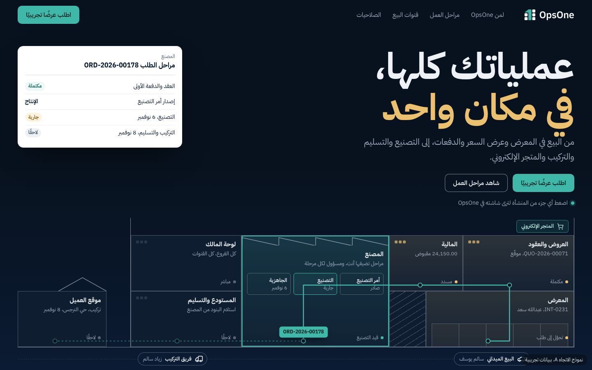
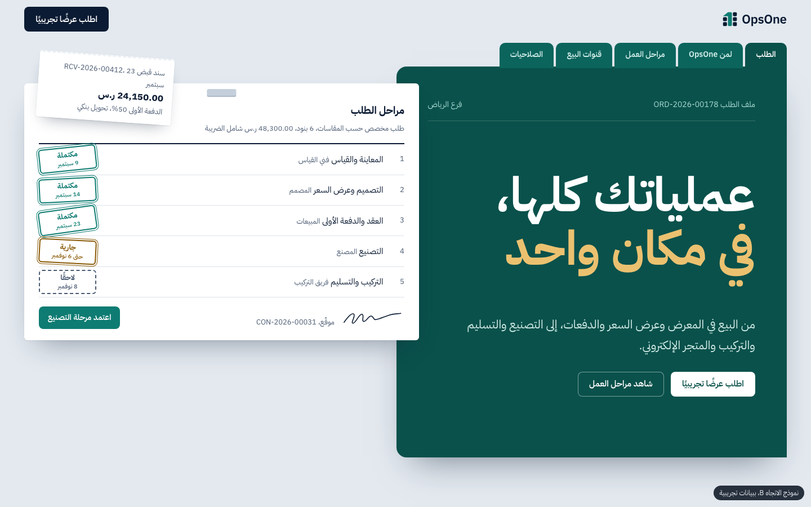
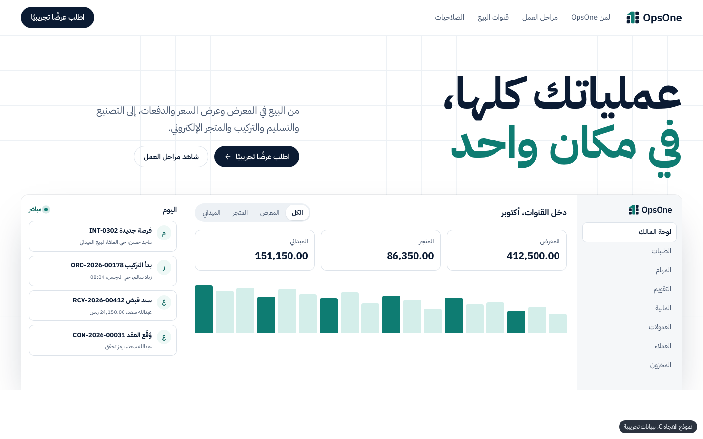

# OpsOne site-next: المرحلة 1 (الاتجاه الفني والخطة)

موقع تسويقي جديد منفصل عن الصفحة المعتمدة `marketing/landing/` (لم تُعدَّل). هذه المرحلة تقدّم الاتجاهات والخطة فقط؛
البناء الكامل ينتظر الاعتماد.

| الملف | المحتوى |
|---|---|
| `directions/a-cutaway.html` | الاتجاه A «المنشأة في مقطع» (الموصى به) |
| `directions/b-docket.html` | الاتجاه B «ملف الطلب» |
| `directions/c-console.html` | الاتجاه C «غرفة التشغيل» (معيار الفئة على مستوى Ramp وClerk) |
| `directions/screens/*-1440.png`، `*-375.png` | لقطات كل اتجاه |
| `FRAMEWORK.md` | إطار التصميم والحركة القابل لإعادة الاستخدام |
| `assets/` | خط IBM Plex Sans Arabic وشعار OpsOne، منسوخان من الصفحة الحالية دون تعديل |

لفتح النماذج محليًا:

```bash
python3 -m http.server 8090 --directory marketing/site-next
```

ثم `http://localhost:8090/directions/a-cutaway.html`. كل نموذج يحمل شارة «نموذج، ببيانات تجريبية».

## 1. فحص مهارة Taste

- المستودع المرجعي `Leonxlnx/taste-skill` (MIT) يشحن مهارة واحدة اسمها `design-taste-frontend` («tasteskill v2»).
  آخر إصدار 2.1.5 (commit بتاريخ 2026-10-24).
- النسخة المحلية `~/.claude/skills/design-taste-frontend` هي **المهارة نفسها، لكنها أقدم قليلًا**: البنية والأقسام الأربعة عشر متطابقة،
  وSKILL.md فيها 530 سطرًا مقابل 542 في الأصل. ينقصها ما أضافه 2.1.5 (قاعدة الاسم الميسّر لكل عنصر تحكم، وفحص نسخة الإنتاج،
  وسبب إعادة الرسم الثالث)، وغالبًا إصلاح escaping في `charts.js`.
- عليها سطر محلي غير موجود في الأصل: `disable-model-invocation: true`. لذلك رفضت أداة Skill تشغيلها، ولم أشغّل سكربتاتها
  ولم أكرّر سير عملها بطريقة أخرى احترامًا لهذا الإعداد.
- أمر التحديث الرسمي (لم أشغّله):

```bash
npx skills add https://github.com/Leonxlnx/taste-skill --skill "design-taste-frontend"
```

  أو عبر plugin في Claude Code: `/plugin marketplace add Leonxlnx/taste-skill` ثم `/plugin install taste-skill@taste-skill`.
  يتطلب Node 22+ وChrome/Chromium.

## 2. المكتبات والمراجع

| المكتبة | التقنية | الترخيص | الكلفة | RTL | الملاءمة (5) |
|---|---|---|---|---|---|
| dqnamo Kitchen | React/Next، Tailwind، motion، three | **لا ترخيص** (كل الحقوق محفوظة) | تختلف لكل قطعة | يدوي | 3، أفكار فقط |
| Kokonut UI | React، shadcn، Motion | MIT، وPro مدفوع | React + motion | يدوي | 2 |
| Skiper UI | React، Motion | غير مؤكد، أغلبه مدفوع | React + motion | يدوي | 1 |
| Vengeance UI | React/Next، Tailwind | MIT | framer-motion/gsap/three/lenis | يدوي | 2 |
| Animmaster Lib | Vanilla، GSAP، WebGL | غير مؤكد (اشتراك Patreon) | GSAP + WebGL | يدوي | 2 |
| ThreeUI (Sylva) | Three.js | MIT للنسخة المجتمعية، Pro مدفوع | three ≈ 150kB+ | محايد | 2، hero فقط |
| Animata | React، Tailwind، motion | MIT | React + motion | يدوي | 2 |
| Motion (vanilla) | JS | MIT | 0.5–22kB | إزاحات يدوية | 4 |
| GSAP + ScrollTrigger | JS | مجاني، رخصة خاصة | ≈ 46kB، **مضمَّن أصلًا** | إزاحات يدوية | **5** |

**dqnamo Kitchen** (اهتمام خاص): 15 دراسة واجهة على موقع شخصي، لا مكتبة: Receipt Printer، Ticket، Stamp، Animated
Signature، Hold to Confirm، Scramble Text، Scroll Fade List وغيرها. المصدر في `github.com/dqnamo/website` بلا ملف ترخيص،
فلا يُنسخ منه كود. لكن ثلاثة من أنماطه (الختم، الإيصال، التوقيع المتحرك) تخص عالم OpsOne مباشرة، ونعيد تنفيذها بأنفسنا
في الاتجاهين A وB.

**المراجع:**
- ramp.com/en-gb: hero بحقل إجراء مباشر، شريط شعارات، شريط أرقام. لا نملك عملاء ولا أرقامًا، فنأخذ منه انضباط الإيقاع
  وجرأة النوع فقط، لا الأدلة الاجتماعية.
- clerk.com: لقطات منتج حقيقية تفاعلية بدل الصور، وشبكة خطوط دقيقة. الاتجاه C يطبّق هذا مباشرة.
- prompt-motion.com: معرض فيديوهات حركة مولّدة؛ يفيد نمط «طلب ينتقل بين الحالات» ومخطط سير عمل متحرك.
- motionsites.ai: سوق قوالب مدفوعة؛ أغلب مشاهد الـ 3D فيه أثقل من ميزانيتنا.
- Awwwards وPinterest: لم يُجلبا آليًا. الحركة في Ramp وClerk لم تُشاهَد فعليًا (الجلب نصّي)، فتفاصيلها غير مؤكدة.

**المكدّس الموصى به:** HTML وCSS وJS ثابتة بلا build (كما في ADR-0034)، GSAP + ScrollTrigger محرّكًا وحيدًا
للقسم المثبّت، وCSS لكل ما عداه. لا React، ولا مكتبة مكوّنات، ولا Three.js.

## 3. تدقيق الصفحة الحالية (impeccable)

المصادر: `impeccable context`، و`impeccable detect --json` على `marketing/landing/index.html` (10 ملاحظات: 9 cramped-padding
و1 dark-glow، وكلها سبق تصنيفها false positive في `REDESIGN-AUDIT.md`)، ولقطات جولة إعادة التصميم، وقراءة الكود.

**يبقى:**
1. لقطات المنتج المبنية بـ HTML ببيانات تتسق أرقامها (48,300.00 = 2 × 24,150.00). هي الدليل الأقوى، ولا يملكها منافس.
2. محرر المراحل بالإصدارات (مسودة، تجربة، اعتماد، والطلبات الجارية تبقى على إصدارها).
3. الطباعة العربية، والأرقام الجدولية، وتقليل الحركة، وقبول الأرقام الهندية في الجوال.
4. SEO وJSON-LD، وتحميل الوسوم بعد الموافقة فقط، وسلوك النموذج وأحداث التحويل وUTM.
5. النصوص المعتمدة حرفيًا.

**يتغيّر:**
1. **لا عالم بصري خاص**: hero بعنوان في الوسط فوق نافذة تطبيق هو قالب الفئة نفسه. الهوية الوحيدة كانت زاوية مقطوعة كملصق.
2. **إيقاع واحد**: الأقسام تتوالى بالكثافة نفسها؛ قائمة مسطّرة، ثم لقطة، ثم قائمة. لا قسم هادئ يقابل قسمًا كثيفًا.
3. **الحركة**: كشف `data-reveal` على 49 عنصرًا تقريبًا. يُستبدل بلحظة واحدة لكل صفحة.
4. **صفحة واحدة طويلة** تحمل كل الوحدات؛ الموقع الجديد يوزّعها على صفحات، والرئيسية تبقى مركّزة.

**ملاحظات محتوى تخالف القواعد الحالية** (في الصفحة المعتمدة، لا أعدّلها هناك):
- «عربي وإنجليزي / واجهة عربية كاملة» في `#benefits`، وفي PRODUCT.md «in Arabic». القاعدة: لا يوصف النظام بـ«عربي».
- عرض السعر يذكر «عبدالله سعد صالح» (ثلاثة أجزاء). القاعدة: اسمان فقط.
- أسماء نسائية في البيانات التجريبية (هيفاء سعد، منيرة علي، ريم يوسف، سارة أحمد، نورة محمد). القاعدة تمنع الصور لا الأسماء؛
  النماذج الجديدة تتجنبها احتياطًا، والقرار للمالك.
- «فواتير إلكترونية متوافقة مع هيئة الزكاة» في «لمن OpsOne؟» مقابل شارة «قيد الإطلاق» على الفاتورة.

## 4. الاتجاهات الثلاثة

أداة impeccable (`concept-seed --scope direction --mode persuade`، seed:432f6bedd5f7e99f) رتّبت سبعة عوالم من بيئة الجمهور
واختارت الثالث للبناء. صفحة القرار التفاعلية في impeccable لم تُفتح لأن هذه جلسة فرعية بلا مستخدم يجيب مباشرة، والبناء
code-led (لا أداة توليد صور معتمدة). المتحدّون الستة رُفضوا جميعًا على محوري تعرّف الجمهور ووضوح المنتج، وأخذ الاتجاه A منهم
انضباطين: «محطات بالترتيب ونقاط التزام لا رجعة بعدها» (الغرفة المظلمة)، و«لكل كتلة مصدرها: من ومتى» (اللحاف).

### A. المنشأة في مقطع (الموصى به)



- **الفكرة:** «في مكان واحد» حرفيًا: المنشأة كلها مرسومة كمقطع معماري ليلي. المعرض على الشارع، العروض والعقود والمالية
  في الطابق العلوي، المصنع بسقفه المسنّن في الخلف، المستودع والتسليم في الجانب، وموقع العميل في آخر الطريق. مسار الطلب خط
  teal يمرّ في الغرف بترتيب العمل. نوافذ الغرف شبكة مربعات مأخوذة من شبكة شعار OpsOne نفسه.
- **النوع:** IBM Plex Sans Arabic 700 للعرض، 400/600 للنص. السطر الثاني من العنوان بالكهرماني.
- **اللون:** ليل `#08121F` إلى `#0B1B33`، خطوط معمارية بيضاء شفافة، كهرماني للغرف المكتملة (أضواء مشتعلة)، teal للجارية والمسار.
- **الشبكة:** 12 عمودًا بمناطق مسمّاة، تتحول إلى مبنى من 4 أعمدة وطوابق مكدّسة على الجوال.
- **الصور:** لا صور فوتوغرافية ولا أشخاص. رسم خطي + لقطات منتج حقيقية. مركبات من أيقونات Lucide.
- **الحركة:** يرسم المسار نفسه حتى المرحلة الجارية، ثم تصل بطاقة `ORD-2026-00178`؛ في الصفحة الرئيسية يتابع المسار التمرير
  عبر الأقسام، وتضيء الغرفة الموافقة لكل نقطة في «لمن OpsOne؟».
- **الـ hero:** العنوان المعتمد في البداية، وشاشة OpsOne «مسحوبة» من الغرفة المختارة في النهاية، والمبنى بعرض الصفحة.
- **التفاعل الحي:** كل غرفة زر؛ الضغط عليه يعرض شاشتها في OpsOne (فرصة البيع، عرض السعر، خطة الدفعات، مراحل التصنيع، لوحة
  المالك، مواعيد التسليم، المتجر، يوم البائع الميداني).
- **الخطر:** الأثقل تنفيذًا؛ يجب ألا يوحي المصنع بقطاع بعينه، وأن يبقى المقطع مقروءًا على 375.
- لقطة الجوال: `directions/screens/a-cutaway-375.png`.

### B. ملف الطلب



- **الفكرة:** الطلب الواحد كالملف الورقي الذي كان يتنقل بين المعرض والمكتب والمصنع؛ يجمع ختمًا في كل مرحلة.
- **النوع:** Plex Arabic؛ الأختام بوزن 700 داخل إطار مزدوج.
- **اللون:** Committed: غلاف teal-deep `#0A514B` يملك نصف الشاشة على مكتب رمادي بارد `#E3E9EF` وورق أبيض. لا cream.
- **الشبكة:** غلاف وورقة مسحوبة نصفها؛ ألسنة الملف هي التنقل بين الأقسام.
- **الصور:** ورق، أختام، سند قبض مدبّس، توقيع مرسوم.
- **الحركة:** الختم يُضغط بـ spring، الأوراق تنزلق إلى الملف مع التمرير.
- **التفاعل الحي:** زر «اعتمد مرحلة التصنيع» يختم المرحلة وينقل «جارية» إلى فريق التركيب.
- **الخطر:** الحنين للورق قد يقرأ كأن المنتج أرشفة، لا تشغيل؛ يقوى في صفحة «مراحل العمل» أكثر من الرئيسية.
- لقطة الجوال: `directions/screens/b-docket-375.png`.

### C. غرفة التشغيل (معيار الفئة)



- **الفكرة:** معيار الفئة كما في Ramp وClerk، منفَّذ بإتقان: أرضية بيضاء بشبكة إنشائية دقيقة، عنوان كبير، ونافذة التطبيق
  الحقيقية هي البطل، وأحداث اليوم تصل حية.
- **النوع:** Plex Arabic 700، أزرار حبوب داكنة.
- **اللون:** Restrained: أبيض وحبر وteal واحد.
- **الشبكة:** 12 عمودًا، عنوان ونص متجاوران، ثم نافذة التطبيق بعرض الحاوية.
- **الحركة:** أحداث تدخل من الأعلى كل 2.6 ثانية، أعمدة تنمو مرة واحدة.
- **التفاعل الحي:** فلتر القنوات (الكل / المعرض / المتجر / الميداني).
- **الخطر:** مألوف؛ يمكن أن يكون لأي SaaS. أعمدة الرسم البياني زخرفية بلا بيانات حقيقية.
- لقطة الجوال: `directions/screens/c-console-375.png`.

### فحص impeccable detect على النماذج

- A: ملاحظة واحدة `repeating-stripes-gradient`، وهي التظليل المعماري لبيت الدرج، مقصودة.
- B: 6 `cramped-padding` (الأختام المائلة والألسنة؛ تُراجع عند البناء). أُصلحت 8 ملاحظات تباين قبل الالتزام.
- C: `nested-cards` و`codex-grid-background` و`pulsing-dot`، وهي علامات معيار الفئة نفسه، وجزء من سبب عدم التوصية به.

### المقارنة والتوصية

| المعيار | A المقطع | B الملف | C غرفة التشغيل |
|---|---|---|---|
| تعرّف صاحب المعرض/المصنع على نفسه | عالٍ جدًا (مبناه هو) | عالٍ (ملفه الورقي) | متوسط |
| وضوح المنتج في أول شاشة | عالٍ: كل الأقسام في نظام واحد | عالٍ للمراحل، أقل للقنوات والمالية | عالٍ للوحة المالك |
| التفرّد | لا يشبه أي موقع في الفئة | متميز | مألوف |
| الامتداد لبقية الصفحات | كل صفحة «غرفة» من المبنى | كل صفحة «ورقة» من الملف | يمتد بسهولة |
| كلفة البناء والأداء | الأعلى، لكن SVG/CSS بلا WebGL | متوسطة | الأقل |

**التوصية: A «المنشأة في مقطع».** هو الوحيد الذي يترجم العنوان المعتمد «في مكان واحد» إلى صورة، ويعرض القنوات الثلاث
(باب المعرض، لافتة المتجر، سيارة البائع) والمصنع الاختياري في مشهد واحد. B مرشّح قوي لصفحة «مراحل العمل» لكنه لا يحمل
الموقع كله، وعالم واحد يملك الموقع. C هو الباب الآمن إن فضّلتم المألوف.

### Figma والفيديو

- Figma: أدوات Figma MCP متاحة في الجلسة، ولم أدفع الاتجاه إليها قبل الاعتماد (اختياري). بعد الاعتماد يمكن نقل hero A إلى ملف Figma جديد.
- Google Flow / فيديو بالذكاء الاصطناعي (اقتراح فقط، لم يُستعمل): مقطع 8 ثوانٍ للـ OG والإعلانات بأسلوب المقطع المعماري.
  - الإطار 1: المبنى مظلم، مقطع خطي على أرضية ليلية. «Architectural cross-section line drawing of a two-storey retail
    showroom with an office floor, a sawtooth-roof factory hall behind, and a loading bay, night, thin white lines on deep
    navy, no people, no text, flat orthographic view.»
  - الإطار 2: نافذة المعرض تضيء بالكهرماني، يبدأ خط teal من بابه.
  - الإطار 3: الخط يصعد إلى الطابق العلوي، تضيء غرفتان.
  - الإطار 4: الخط يدخل المصنع، تنبض نقطة teal.
  - الإطار 5: شاحنة تخرج إلى الطريق نحو بيت صغير يضيء. يُضاف الشعار والعنوان في المونتاج لا في التوليد.
  - القيود: بلا أشخاص، بلا نص مولّد، بلا عناصر تدل على قطاع.

## 5. خريطة الموقع المقترحة

كل صفحة من قدرات موجودة فعلًا في `src/` وفي النصوص المعتمدة. «القسم» = المكوّن، المرجع، الحركة.

### `/` الرئيسية

| القسم | المكوّنات | المرجع | الحركة |
|---|---|---|---|
| hero «عملياتك كلها، في مكان واحد» | المقطع المعماري، شاشة الغرفة، زرّا الإجراء | النموذج A | رسم المسار مرة واحدة، تبديل الشاشة 260ms |
| «لمن OpsOne؟» (6 نقاط حرفيًا) | قائمة مسطّرة + مبنى مصغّر | Clerk (لقطات بدل أيقونات) | تمرير الماوس/التركيز على نقطة يضيء غرفتها |
| «من أول اتصال إلى آخر توقيع» (9 نقاط، منها «غيّر طريقة عمل النظام كما يناسبك») | قسم مثبّت، لكل خطوة لقطة منتج | Ramp (إيقاع)، dqnamo (ختم، توقيع) | **اللحظة التوقيعية**: المسار يتقدم خطوة مع التمرير (ScrollTrigger) |
| «ثلاث قنوات بيع، ونظام واحد» | ثلاثة مداخل للمبنى، يوم البائع الميداني، دخل القنوات | النموذج A | تبديل القناة 220ms |
| الصلاحيات | تبويبات الأدوار (المدير، المبيعات، الفني) | الصفحة الحالية | بلا حركة إضافية |
| كل ما في OpsOne | فهرس الوحدات الاثنتي عشرة بروابط للصفحات | — | لا شيء |
| «جرّب OpsOne على طلباتك» | النموذج الحالي كما هو | الصفحة الحالية | حالات النموذج فقط |
| التذييل | روابط الصفحات، الخصوصية، «تطوير Available Solutions» | — | — |

### الصفحات الأخرى بالأولوية

1. `/demo` «اطلب عرضًا تجريبيًا»: النموذج وحده، مع ما يحدث بعد الإرسال. هدف الحملات الإعلانية.
2. `/journey` «من أول اتصال إلى آخر توقيع»: الخطوات التسع بتفصيل أكبر، لكل خطوة شاشتها (فرص البيع، المواعيد، العرض، اعتماد التصميم، العقد، الدفعات، الملفات، الزيارات الميدانية، تغيير طريقة العمل).
3. `/channels` «ثلاث قنوات بيع، ونظام واحد»: المعرض، المتجر الإلكتروني، البيع الميداني والعمولات.
4. `/operations` «التصنيع والتسليم والتركيب»: مراحل التصنيع التي يضيفها العميل، المهام والمسؤولون، المخزون والتوريد، التسليم الجزئي والمرتجعات، تطبيق الفني.
5. `/payments` «العروض والعقود والدفعات»: عرض السعر واعتماد الخصم، العقد الموقّع برمز تحقق، خطة الدفعات والسندات والاسترداد، العمولات، والفاتورة الإلكترونية بحالتها الحقيقية.
6. `/teams` «الفروع والصلاحيات»: الأدوار والفروع والمناطق، الاعتمادات، لوحة المالك.
7. `/customize` «غيّر طريقة عمل النظام كما يناسبك»: محرر المراحل والإصدارات (بلا كلمة «No-Code»).
8. `/privacy`: سياسة الخصوصية (النص يحتاج مصدرًا قانونيًا).

## 6. خطة التنفيذ

التقديرات بأيام عمل لجلسة Claude واحدة مع مراجعة، وتشمل اللقطات والفحوص.

| المرحلة | العمل | التقدير |
|---|---|---|
| 0 | اعتماد الاتجاه، كتابة عقد الاتجاه في surface brief، ثلاث تركيبات للـ hero (comps) للاختيار، تشغيل Taste من المستخدم | 0.5 يوم |
| 1 | الرئيسية كاملة: المقطع التفاعلي، الأقسام الثمانية، القسم المثبّت، SEO والوسوم والنموذج منقولة، لقطات 1440/768/375، Lighthouse، detect، مراجعة finish | 4 أيام |
| 2 | `/demo` و`/journey` | 2 يوم |
| 3 | `/channels` و`/operations` | 2 يوم |
| 4 | `/payments` و`/teams` و`/customize` | 2.5 يوم |
| 5 | `/privacy`، sitemap، روابط داخلية، break-ui وmobile-native على كل الصفحات، DESIGN.md من impeccable-documenter، تقرير المقارنة مع الصفحة الحالية | 1.5 يوم |
| | **المجموع** | **12.5 يوم تقريبًا** |

## 7. ما يحتاج اعتمادًا أو إجابة

1. **الاتجاه:** A (موصى به) أم B أم C.
2. **خط العرض:** نبقى على IBM Plex Sans Arabic وحده (التزام الهوية)، أم نضيف خطًا متغيّرًا للعناوين (Alexandria أو Readex Pro)؟
3. **صفحات متعددة:** هل نعتمد خريطة الموقع أعلاه، أم تبقى صفحة واحدة وتُضاف الصفحات لاحقًا؟
4. **ملاحظات المحتوى في القسم 3:** «عربي وإنجليزي»، والاسم الثلاثي، والأسماء النسائية، وادعاء الفاتورة المتوافقة مقابل «قيد الإطلاق».
5. **رابط Available Solutions** ونطاق الموقع النهائي وبيانات التواصل ونص الخصوصية.
6. **مهارة Taste:** تحديثها بالأمر الرسمي، وتشغيلها بنفسك `/design-taste-frontend`، أو إزالة `disable-model-invocation` ليستدعيها Claude.
7. **Figma:** هل ننقل الاتجاه المعتمد إلى ملف Figma جديد؟
